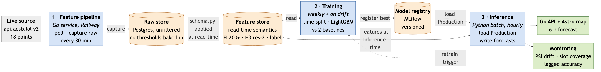

# skyjam — Forecasting GNSS Interference over European Airspace

Module: **I.BA_MLOPS.H2601 · Machine Learning Operations** · Bachelor Informatik, Hochschule Luzern · Autumn Semester 2026.

**The prediction.** For every H3 resolution-2 airspace cell (~180 km edge) over Europe and
adjacent regions, skyjam predicts the probability that the cell will be
**interference-affected 6 hours ahead**. A cell-hour counts as affected when at least 30 %
of the cruise-altitude aircraft in it broadcast a degraded navigation integrity category
(`NIC < 7`) over ADS-B — i.e. the aircraft themselves report that GNSS is not to be
trusted. Success means beating persistence and per-cell hourly climatology on a strictly
out-of-time split (target: PR-AUC ≥ 0.10 above persistence).

There is no historical download for this data: **the feature pipeline is the only source of
history**, which is why a Go service polls the feed continuously from MS1 onwards.

| | |
| --- | --- |
| Proposal (MS1) | [`docs/proposal.pdf`](docs/proposal.pdf) |
| MS2 summary | [`docs/ms2_summary.pdf`](docs/ms2_summary.pdf) |
| Live URL | _by MS4_ |
| Video pitch | _by MS4_ |
| Status | MS2 · hourly capture (Go) and hourly feature build (Python) both run on Railway, writing to Postgres; training and inference are MS3/MS4 |

## Clone and run

```bash
git clone https://github.com/Zayden16/hslu-mlops-hs-26.git
cd hslu-mlops-hs-26
uv sync --locked --all-extras        # pinned via uv.lock
uv run pytest                        # 48 tests (8 need TEST_DATABASE_URL, else skipped)
cp .env.example .env
```

Reading the feature store needs `DATABASE_URL` pointing at the Postgres instance:

```bash
export DATABASE_URL=postgres://...
uv run python -c "from skyjam.common.db import *; print(slot_coverage(get_engine()).tail())"
```

Building the feature store (what the hourly Railway cron runs):

```bash
export DATABASE_URL=postgres://...
uv run skyjam-features                 # rebuild cell_hourly_features + log to feature_runs
uv run skyjam-features --no-store --out features.parquet   # local copy only
docker build -t skyjam-features . && docker run -e DATABASE_URL skyjam-features
```

Training reads the table with `skyjam.common.db.read_features(engine)`.

Deploying (Railway CLI). Each service must be uploaded from its own root, otherwise
the root `railway.json` (Python image, cron) is applied to the Go service:

```bash
railway up --service features --detach                                   # repo root: Python image
railway up services/ingestor --path-as-root --service ingestor --detach  # Go image
```

The `features` cron (`20 * * * *`, start command `skyjam-features`, restart `NEVER`)
is set in the Railway environment config, mirrored in `railway.json` for reference.

The capture service is Go and lives in [`services/ingestor/`](services/ingestor):

```bash
cd services/ingestor
go test ./...                                  # unit tests, no database needed
DATABASE_URL=postgres://... SKYJAM_RUN_ONCE=true go run .   # one sweep
docker build -t skyjam-ingestor .              # the image Railway deploys
```

One sweep takes about 7 minutes and yields roughly 12 000 observations across 18 discs.
Requests are paced at 12 s because the public feed is rate-limited (see below). Data lives
in Postgres and is **not** committed.

Rebuild the milestone PDFs (needs pandoc, xelatex, npx): `./docs/build.sh`

## FTI architecture



| Pipeline | Trigger | Responsibility | State |
| --- | --- | --- | --- |
| Ingest | Go service on Railway, hourly (`:00`) | poll 18 ADS-B discs, capture **unfiltered** observations to Postgres `observations` | **running** |
| Feature | Railway cron `20 * * * *` (Python, root `Dockerfile` + `railway.json`) | raw -> H3 cell-hours -> lags, rolling, neighbour-cell features, 6 h target -> `cell_hourly_features`, audit row in `feature_runs` | **running** |
| Training | weekly + on drift | read features, chronological split, train vs. two baselines, track in MLflow, register best | MS3 |
| Inference | hourly batch (Python) | load the Production model, score live cells, write forecasts to Postgres | MS4 |
| Serving | always on (Go + Astro) | Go JSON API over the forecast table, Astro map frontend | MS4 |

**Language split:** Go wherever a process runs continuously in production (capture,
serving API), Python only where the ML ecosystem is (features, LightGBM training,
MLflow, batch inference). The request path never touches Python.

### Why a Go service instead of a GitHub Actions cron

The first implementation used a scheduled workflow. Measured over 74 h, four staggered
hourly crons captured only **39 distinct hours (53 %)**: GitHub drops scheduled triggers
under load and never retries. For a dataset whose source has no history endpoint, every
missed hour is gone permanently. Snapshots also lived in Actions artifacts capped at 90
days, so the earliest data would have expired on 16.12.2026, before MS4 is graded on
10.01.2027.

A long-lived process with a wall-clock-aligned ticker does not drop ticks, and Postgres
does not expire. The ingest workflow was therefore removed (`746aba3`); the Railway
service is the only capture path.

### Capture stores raw, semantics are applied on read

The Go service stores **every aircraft with a position and a NIC**: raw coordinates, a
nullable altitude, no H3 column, no label. The altitude floor, H3 resolution, NIC
threshold and traffic floor all live in `src/skyjam/common/schema.py` and are applied
when reading, so training and serving cannot drift apart and a threshold can still be
revisited against the whole history.

This was a correction, not just a preference: the previous Parquet layer filtered to
FL200+ and wrote H3 res 3 while the feature store used res 2, which made its documented
"backfill from immutable raw" guarantee impossible to honour.

**Backfill.** The feed has no history endpoint, so backfill means *recomputing*, not
re-downloading: every feature run rebuilds the whole table from the immutable raw
`observations`, so a changed threshold or a new feature is applied to all history at
once (about 40 s for 3.3 M cruise rows). `skyjam-import-legacy` loaded the pre-Postgres
Parquet snapshots.

### Alerting (ntfy)

Both services push to an ntfy topic set in `SKYJAM_NTFY_URL` (a Railway variable, never
committed). Subscribe to the topic in the ntfy app to get phone notifications.

| Alert | Sent by | When | Priority |
| --- | --- | --- | --- |
| `skyjam ingest degraded` | ingestor | first sweep with fewer than 18/18 discs or a failed write | high, **urgent** if 0/18 |
| `skyjam ingest recovered` | ingestor | first fully healthy sweep after that | default |
| `skyjam capture STALE` | features cron | newest captured hour older than 2 h (ingestor down or stuck) | urgent |
| `skyjam features FAILED` / `CRASHED` | features cron | build exits non-zero or raises (previous table kept) | high |

The ingestor alerts only on a state change, so a ten-hour outage gives one alert and one
recovery, not ten. The features cron runs in a separate container and acts as a watchdog
for the ingestor, which cannot report its own death. It repeats every hour while capture
stays stale.

### The feed is rate-limited

`api.adsb.lol` limits via nginx with no `Retry-After` and no quota headers, and documents
the limit as *dynamic based on environment load*. Measured: a burst is cut off after 2-3
requests and recovers after ~15 s. At the original 2 s spacing only 10-12 of 18 discs
completed per sweep; at 12 s spacing with a 16 s base backoff a sweep returns 18/18.
On top of that there is a **500 requests/day** per-IP quota: 30-minute sweeps (864
requests/day) exhausted it every afternoon in October, so sweeps are now hourly
(see [`docs/ingestion-gaps-2026-10.md`](docs/ingestion-gaps-2026-10.md)).

### Feature store: `cell_hourly_features`

One row per (H3 res-2 cell, UTC hour) that was observed with at least 5 cruise aircraft
and whose state 6 h later was also observed. Rebuilt every hour from raw by
`skyjam-features`; every build is logged in `feature_runs` (`run_id`, `feature_version`,
slot range, row count, positive rate).

| Group | Columns | Definition (all computed from slots ≤ t) |
| --- | --- | --- |
| Keys | `h3_cell`, `slot_start` | cell id, start of the UTC hour |
| Current state | `aircraft_count`, `degraded_share`, `median_nic`, `p25_nic`, `mean_nac_p`, `is_degraded` | each aircraft counted once per hour at its worst NIC; `is_degraded` = share ≥ 0.30 |
| Own lags | `degraded_share_lag_{1,2,3,6,12,24,168}h`, `is_degraded_lag_…` | value exactly *k* hours earlier on a gap-free grid; NaN if that hour was not observed |
| Rolling | `degraded_share_mean_{6,24}h`, `aircraft_count_mean_24h` | mean over the previous window, **excluding** hour t |
| Neighbours | `nbr_observed`, `nbr_degraded_share_{mean,max}`, `nbr_degraded_count`, `nbr_degraded_share_mean_lag_{1,3,6}h`, `nbr_degraded_share_delta_3h` | the 6 adjacent cells in the same hour; unobserved neighbours are ignored, never counted as clean |
| Calendar | `hour_utc`, `day_of_week` | from `slot_start` |
| Target | `target_is_degraded` | `is_degraded` of the same cell at t + 6 h. Not a feature |
| Lineage | `feature_version`, `feature_run_id` | which code and which build produced the row |

**Quality gate.** Before the table is replaced, `validate_features` checks unique keys,
binary target, every share within [0, 1], no row below the traffic floor, and a plausible
positive rate. A failing build exits non-zero (shown as a failed cron run on Railway)
and the previous table stays in place.

## Course requirements

- **Format:** individual project, public GitHub repo, kept reachable all semester.
- **Data:** dynamic/live sources only (crypto, weather, SBB delays, …) — no static datasets.
- **Stack:** GitHub, Docker, MLflow or W&B, GitHub Actions or Airflow.
- **Deployment:** cloud deployment is mandatory (GCP / AWS / Hugging Face). USD 50 GCP credits available for students.
- **Grading focus:** the pipeline, not model accuracy. A fully automated pipeline at 60% beats a manual notebook at 99%.

## Milestones and deadlines

| Milestone | Due | Weight | Deliverable |
| --- | --- | --- | --- |
| MS1 Proposal | Thu 01.10.2026, 23:59 (ILIAS) | 10% | max. 2-page PDF, also committed as `docs/proposal.pdf` |
| MS1 Reviews | Thu 08.10.2026 | 10% | 2 anonymous peer reviews |
| MS2 Feature Pipeline | Thu 05.11.2026 | 10% | repo state + `docs/ms2_summary.pdf` |
| MS2 Reviews | Thu 12.11.2026 | 10% | 2 peer reviews |
| MS3 Training Pipeline | Thu 03.12.2026 | 5% | repo state + `docs/ms3_summary.pdf` |
| MS3 Reviews | Thu 10.12.2026 | 5% | 2 peer reviews |
| Oral Exam (Q&A) | Thu 17.12.2026 | 30% | ~15 min individual, on this repo, no presentation |
| MS4 Live System | Sun 10.01.2027 | 20% | code freeze, deployed URL, max. 3 min video pitch, `docs/ms4_summary.pdf` |

Milestones are graded at the **last commit before the deadline**. Tag them: `git tag ms2 && git push --tags`.

### Milestone contents

- **MS1 Proposal:** problem statement (what, horizon, success criterion vs. a baseline), originality & motivation, data source & features (update frequency, label, leakage/split), system design (embedded FTI diagram, stack, repo link).
- **MS2 Feature pipeline:** automated ingestion + backfill, feature engineering & storage, scheduled execution (not manual), Docker image, pinned deps, README.
- **MS3 Training pipeline:** reads MS2 features, reproducible training & evaluation without leakage, MLflow/W&B tracking, model registered, auto-retrain trigger.
- **MS4 Live system:** all 3 pipelines + feature store, scheduled automation and cloud deploy, serving UI, observability (tracking, deployed version, drift monitoring), tests/Docker/pinned deps.

Each milestone summary (max. 2 pages) contains what was achieved **and** a numbered response to every reviewer point (A1, B1, E1 …) with status `Changed · Partly · Rejected · Not yet` and the commit/file.

## Repository layout

```
├── README.md            prediction · FTI diagram · clone-and-run steps · live URL · video link (by MS4)
├── docs/                proposal.pdf, ms2_summary.pdf, ms3_summary.pdf, ms4_summary.pdf, architecture.png
├── services/ingestor/   Go capture service (Railway): ADS-B client, sampling grid, Postgres store, migrations
├── src/skyjam/
│   ├── common/          shared code (schema, config, db read path, grid)
│   ├── features/        feature engineering on top of the store
│   ├── training/        training pipeline (read features, train, evaluate, register)
│   └── inference/       inference pipeline (load model, predict, serve)
├── ui/                  Astro frontend (map of the 6 h forecast), fed by the Go API
├── config/              settings without secrets
├── tests/               unit tests, run in CI
├── notebooks/           exploration only
├── .github/workflows/   CI (Python + Go against a real Postgres)
├── Dockerfile           (+ services/ingestor/Dockerfile for the Go service)
├── pyproject.toml + uv.lock
├── .env.example
└── .gitignore
```

Keep feature definitions in one place shared by training and inference to avoid training–serving skew.

## Rules

- No secrets in the repo or its history. Use `.env` (gitignored) and GitHub Secrets; a leaked key must be rotated.
- No data, model artifacts or `mlruns/` in git.
- Pipelines never import from notebooks.
- AI tools are allowed, but every line and decision must be explainable at the oral exam.
- Individual work; inspiration from mlops-lab.ch and KTH ID2223 is fine, copying is not.

## Course material

`ilias-dump/` (local only, gitignored and not redistributed) holds the ILIAS course export.

Lecturers: Marc Bravin (module head), Florian Bär, Tobias Mérinat, Josiah Rohrer. Thursdays 09:05–11:25, Rotkreuz S1A_209.
